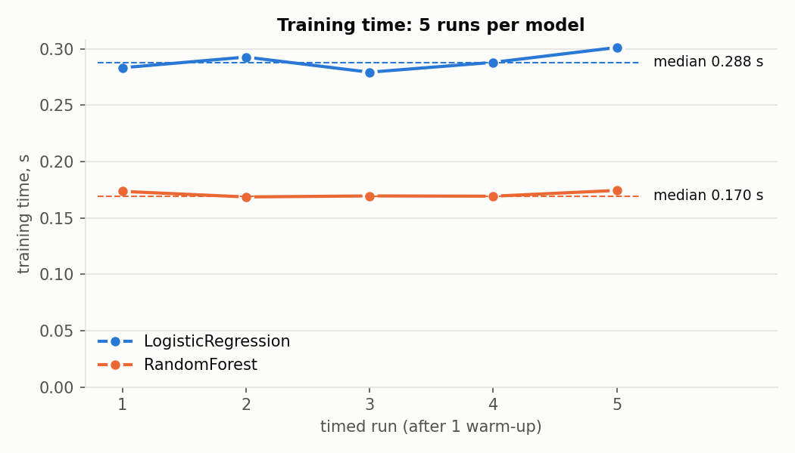
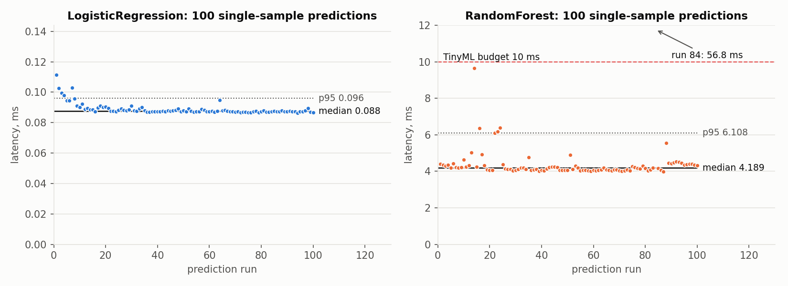

# Lab 1 — Environment and first system measurements

## 1. Goal

Build a reproducible Python environment, train two baseline classifiers on the
Breast Cancer Wisconsin (Diagnostic) dataset, measure their system cost
(training time, single-sample latency, model size, peak memory), and decide on
which deployment tier — Cloud, Edge, Mobile, TinyML — each model could run.

## 2. Method

**Environment.** Python 3.11.8 in an isolated `.venv`, all 25 packages pinned
to the versions in the lab manual. `src/print_versions.py` compares every
installed version with its pin; the output in `results/versions.txt` shows
0 mismatches. The pinned set has one internal conflict: `mlflow==2.14.1`
requires `pyarrow<16` while the manual pins `pyarrow==16.1.0`. To keep every
pin exact, mlflow was installed without dependency resolution and its other
dependencies were installed separately (steps in the repo `README.md`).
mlflow is not used in this lab.

**Hardware.** AMD Ryzen 7 2700X (8 cores / 16 threads), 16 GB RAM,
Windows 10 Pro 19045, CPU only.

**Data and models.** `load_breast_cancer(return_X_y=True)`: 569 samples, 30
features. Split 70/30, stratified, `random_state=42` → 398 train / 171 test,
benign share 0.628 / 0.626. Seeds 42 for `random`, `numpy`, `torch`,
`torch.cuda`. Models exactly as specified, no preprocessing:
`LogisticRegression(max_iter=1000, random_state=42)` and
`RandomForestClassifier(n_estimators=100, random_state=42)`.

**Measurements.**

| Metric | Procedure |
|---|---|
| Training time | 1 warm-up fit, then 5 timed fits on a fresh clone each; median |
| Single-sample latency | `predict` on one test row; 1 warm-up, then 100 timed calls; median (p95 shown for spread) |
| Model size | `joblib.dump` of each model; file size in bytes and KB (1 KB = 1024 B). Both models are also saved together in `results/model.joblib` (291 658 B) |
| Peak memory (training process) | `memory_profiler` samples RSS every 1 ms from a separate process during `fit` and during 100 predictions |
| Peak memory (deployment process) | A fresh process that imports only numpy, sklearn and joblib, loads one model and predicts the sample 100 times; peak RSS taken from psutil (incl. Windows `peak_wset`) |
| Parameter bytes | Size of the fitted numeric arrays (coefficients, or tree node and value arrays) |

All timers use `time.perf_counter`. Every individual run is saved in
`results/raw_timings.json`; per-run tables and plots are produced from it by
`src/plot_timings.py`.

**Deployment check.** Each model is compared with the manual's budgets in two
scenarios: *python* (served as measured — deployment-process RSS and joblib
file size) and *native* (exported to plain code with no Python runtime —
memory and size = parameter bytes). For tiers given as a memory range, the
model "fully" fits if it is below the smallest device in the tier and
"partially" fits if it is below only the largest one.

## 3. Results

### Accuracy (`results/baseline_accuracy.csv`)

| Model | Test accuracy |
|---|---|
| LogisticRegression | 0.9415 |
| RandomForest | 0.9357 |

### System cost (`results/system_cost.csv`)

| Metric | LogisticRegression | RandomForest |
|---|---:|---:|
| Training time, median of 5 | 288.10 ms (0.288 s) | 169.57 ms (0.170 s) |
| Single-sample latency, median of 100 | 0.088 ms | 4.189 ms |
| Single-sample latency, p95 | 0.096 ms | 6.108 ms |
| Model size (joblib) | 1 055 B = 1.03 KB | 290 889 B = 284.07 KB |
| Parameter bytes | 248 B | 251 040 B |
| RSS before training (process with torch loaded) | 264.8 MB | 266.1 MB |
| Peak RSS during training | 264.9 MB | 266.1 MB |
| Peak RSS during inference | 264.9 MB | 266.2 MB |
| Deployment process: bare interpreter | 16.5 MB | 16.4 MB |
| Deployment process: after numpy + sklearn import | 95.6 MB | 95.7 MB |
| Deployment process: after model load | 95.7 MB | 96.8 MB |
| **Deployment process: peak RSS** | **95.8 MB** | **97.0 MB** |

### Every timing run (`results/training_runs.csv`, `results/inference_stats.csv`)

Following the manual, training was timed **5 times** per model (after 1
warm-up fit) and single-sample prediction **100 times** per model (after 1
warm-up call). All individual runs are shown below, not only the medians.

**Training — 5 runs, seconds:**

| Run | LogisticRegression | RandomForest (100 trees) |
|---:|---:|---:|
| 1 | 0.2833 | 0.1736 |
| 2 | 0.2928 | 0.1687 |
| 3 | 0.2794 | 0.1696 |
| 4 | 0.2881 | 0.1693 |
| 5 | 0.3013 | 0.1745 |
| min | 0.2794 | 0.1687 |
| **median** | **0.2881** | **0.1696** |
| max | 0.3013 | 0.1745 |
| spread (max − min) / median | 7.6 % | 3.4 % |

**Single-sample prediction — 100 runs:**

| Statistic over 100 runs | LogisticRegression | RandomForest |
|---|---:|---:|
| min | 0.0863 ms | 3.996 ms |
| **median** | **0.0876 ms** | **4.189 ms** |
| mean | 0.0890 ms | 4.892 ms |
| p95 | 0.0960 ms | 6.108 ms |
| max | 0.1113 ms | 56.818 ms |
| total time of all 100 predictions | 0.0089 s | 0.4892 s |
| predictions per second (1 / median) | ≈ 11 400 | ≈ 240 |

What the individual runs show:

* **Training is stable.** All five runs of each model lie within a few percent
  of the median, so the median of 5 is a reliable number. Training 100 trees on
  398 samples takes ≈ 0.17 s; the logistic regression takes ≈ 0.29 s because
  lbfgs runs the full 1000 iterations.
* **One warm-up call is not always enough.** The first ~10 logistic-regression
  predictions are up to 27 % slower (0.11 ms vs 0.088 ms) before the latency
  settles, which is CPU caches and branch predictors warming up.
* **A single outlier can wreck the mean.** Run 84 of the forest took 56.8 ms,
  ≈ 14× its median, most likely because the OS scheduled another process at that
  moment. That one run pulls the mean up to 4.89 ms, while the median stays at
  4.19 ms. This is why the manual asks for the median, not the mean or a single
  run. The outlier also crosses the 10 ms TinyML latency budget, so a hard
  real-time target would have to plan for the tail (p95 or max), not only the
  median.

### Deployment fit (`results/deployment_fit.csv`)

Budgets: Cloud ≥ 1 GB / ≤ 100 ms / ≤ 500 MB; Edge 256–1024 MB / ≤ 50 ms /
≤ 50 MB; Mobile 64–256 MB / ≤ 20 ms / ≤ 10 MB; TinyML ≤ 256 KB / ≤ 10 ms /
≤ 100 KB.

**Scenario *python* (as measured):**

| Model | Cloud | Edge | Mobile | TinyML |
|---|---|---|---|---|
| LogisticRegression | Yes | Yes | Partial — 95.8 MB fits a 256 MB phone, not a 64 MB one | No — memory 95.8 MB ≫ 256 KB |
| RandomForest | Yes | Yes | Partial — 97.0 MB, same as above | No — memory 97.0 MB ≫ 256 KB and size 284 KB > 100 KB |

**Scenario *native* (no Python runtime):**

| Model | Cloud | Edge | Mobile | TinyML |
|---|---|---|---|---|
| LogisticRegression | Yes | Yes | Yes | Yes — 248 B of parameters |
| RandomForest | Yes | Yes | Yes | No — 245 KB > 100 KB size budget; memory 245 KB leaves almost no headroom below 256 KB |

Latency passes every budget for both models (worst case RandomForest p95
6.1 ms < 10 ms TinyML), but it was measured on a desktop CPU. On a phone or a
microcontroller it would be slower: the RandomForest margin to the TinyML
10 ms limit is small, while the logistic regression (30 multiply-adds) has a
large margin.

**Decision.**
* **LogisticRegression** — runs on Cloud and Edge as is, on Mobile devices with
  more than ~100 MB free, and on TinyML once exported to native code. It is
  the better choice for constrained targets: slightly higher accuracy,
  275× smaller file, ~48× lower latency.
* **RandomForest** — runs on Cloud and Edge, on larger Mobile devices with the
  Python runtime (or on any Mobile device natively), but not on TinyML: its
  100 trees exceed the 100 KB size budget even without Python. It would need
  fewer or shallower trees.

**Note on measurement.** With `include_children=True`, `memory_profiler` on
Windows also counted its own monitor process, which re-imports the script, and
reported a false doubling of memory (≈529 MB). The final numbers use the main
process only.

## 4. Conclusions

1. **The runtime, not the model, sets the memory cost.** Both models
   need ~96–97 MB in a deployment process, and ~95 MB of that is Python, numpy
   and sklearn. The model itself adds 0.1–1.3 MB. In the training script the
   process is even larger (~265 MB) only because torch is imported for
   seeding. Because of this, "where can it run" depends on the serving stack
   at least as much as on the model. Moving to native code shrinks
   LogisticRegression from ~96 MB to 248 bytes and makes it fit TinyML.

2. **Model complexity shows up in latency and size, not in accuracy.** The
   100-tree forest is 275× larger and ~48× slower per prediction than the
   linear model, and it is not more accurate on this split
   (0.9357 vs 0.9415). For a small tabular problem like this, the extra
   capacity buys only system cost, and the size budget is what rules the
   forest out of TinyML.

3. **Training cost and inference cost are different things, and measuring them
   correctly takes care.** The logistic regression is the slower model to
   train (288 ms vs 170 ms) because the unscaled features make lbfgs run to
   its 1000-iteration limit (sklearn warns it did not converge). Yet it is the
   faster model to serve. The memory-profiler artefact also showed that a
   tool's default settings can silently distort a measurement. Medians over
   repeated runs, a warm-up, and a check that the numbers make sense were
   needed for trustworthy results.

## Reproduce

From the repo root, with the `.venv` active:
`python lab01/src/print_versions.py > lab01/results/versions.txt`, then
`python lab01/src/train_baselines.py`, `python lab01/src/measure_system_cost.py`,
`python lab01/src/plot_timings.py`, `python lab01/src/deployment_fit.py`.
